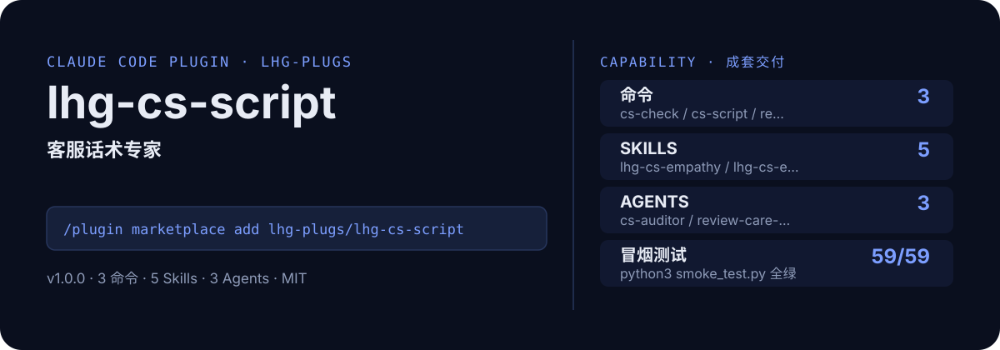

<!-- About 简介（推送后填写到仓库 About 栏）：
客服话术专家：高频场景话术库生成、差评管理（review-care）、话术自查三件套，16 条规则硬检禁用语与过度承诺。 ｜ 一键安装：/plugin marketplace add lhg-plugs/lhg-cs-script
-->
<!-- topics（推送后打）：claude-code, claude-plugin, agent-skills, customer-service, cs-script, review-care, bad-review, complaint -->

<p align="center">
  
</p>

> **一句话介绍**：客服话术专家：高频场景话术库生成、差评管理（review-care）、话术自查三件套，16 条规则硬检禁用语与过度承诺。

**一键安装**：在 Claude Code 里运行

```bash
/plugin marketplace add lhg-plugs/lhg-cs-script
/plugin install lhg-cs-script@lhg-plugs
```

## 它能帮你做出什么

- **冒烟全绿**：`python3 smoke_test.py` 59 项全部通过（JSON 合法、frontmatter 完整、命令/skill/agent 齐全）。

## 它是什么

`lhg-cs-script` 是一个 Claude Code 插件（plugin 为主、skill 为辅）：

- **3 个命令**（小白入口）：`cs-check` 话术自查、`cs-script` 高频客服场景 → 话术库生成、`review-care` 差评管理子命令
- **5 个平台中立 skill**（方法论，可移植到豆包/Workbuddy 等 agent 平台）：lhg-cs-empathy, lhg-cs-escalate, lhg-cs-method, lhg-cs-review, lhg-cs-root
- **3 个专家 agent**：cs-auditor, review-care-agent, script-writer
- **2 个 hooks**（`hooks/`：post_write_warn.py, pre_commit_audit.py），关键操作前自动把关

## 为什么是它

不是一个 prompt，而是一套互相兜底的机制：

1. **硬门，不是提醒**：hooks 在关键操作前自动拦截或警告（见 `hooks/`），而不是只在文档里写一句"请注意"。
2. **方法论沉淀在 skill 里**：流程、检查清单、口径都写在 `skills/` 的方法论里，命令只是入口；换个 agent 平台也能复用同一套做法。
3. **可验，不是可信**：`fixtures/` 备有坏/好对照用例，`smoke_test.py` 一键验证，规则有没有生效、自己跑一遍就知道。

## 快速上手

```bash
# 1. 安装（Claude Code 里运行）
/plugin marketplace add lhg-plugs/lhg-cs-script
/plugin install lhg-cs-script@lhg-plugs

# 2. 高频客服场景 → 话术库生成：安抚、解释、补偿、转人工 SOP 四类话术一次备齐
/lhg-cs-script:cs-script "生鲜电商售后"
```

| 命令 | 作用 | 示例 |
|---|---|---|
| `/lhg-cs-script:cs-check` | 话术自查：禁用语、过度承诺、差评回复完整度、转人工条件，脚本+人工双检。 | `/lhg-cs-script:cs-check ./scripts` |
| `/lhg-cs-script:cs-script` | 高频客服场景 → 话术库生成：安抚、解释、补偿、转人工 SOP 四类话术一次备齐。 | `/lhg-cs-script:cs-script "生鲜电商售后"` |
| `/lhg-cs-script:review-care` | 差评管理子命令：差评内容 → 情绪分级 → 公开回复模板 → 私下跟进 SOP，双轨处理。 | `/lhg-cs-script:review-care "等了 10 天还没发货，太差了"` |

## 什么时候用 / 什么时候不用（FAQ）

**什么时候用：**

- 你需要话术自查时 → 用 `/lhg-cs-script:cs-check`
- 你需要高频客服场景 → 话术库生成时 → 用 `/lhg-cs-script:cs-script`
- 你需要差评管理子命令时 → 用 `/lhg-cs-script:review-care`

**什么时候不用：**

- 你只需要其中一个零散能力时 → 本插件是成套流程，单点需求用更轻量的 skill 更合适
- 你希望 AI 完全自由发挥、不接受任何自查与硬门时 → 它的规则审计与 hooks 会介入（可关，但那就别装它）
- 你的场景不在上面命令表覆盖范围内时 → 先看命令表，没有对应命令就别硬套

## 目录结构

```
lhg-cs-script/
├── smoke_test.py          # 一键冒烟测试
├── ATTRIBUTION.md         # 灵感来源与许可声明
├── LICENSE                # MIT
├── README.md              # 本文件
├── .claude-plugin/
├── agents/
├── commands/
├── fixtures/
├── hooks/
├── scripts/
├── skills/
```

## 自检与反馈

本插件自带质检：每次使用后可跑 `python3 smoke_test.py` 一键验证（本次实测 59 项全部通过）。

发现 bug 或有改进建议，以 `[QC] <一句话问题>` 为标题提交到 https://github.com/lhg-plugs/lhg-cs-script/issues，正文写清"复现步骤 → 实际表现 → 期望表现"。

同门插件见 [lhg-plugs](https://github.com/lhg-plugs)，86 个插件的完整矩阵在 [marketplace](https://github.com/lhg-plugs/marketplace) 维护。

## 出品：刘洪光

本插件由真人出镜 IP「刘洪光」（安徽合肥）出品，归属 [lhg-skills](https://github.com/lhg-skills)。

- GitHub 主页：https://github.com/lhg-skills —— 全部 skill 开源在此，欢迎 star
- 抖音：搜「刘老师讲AI实战」
- 微信：lhgsmsw
